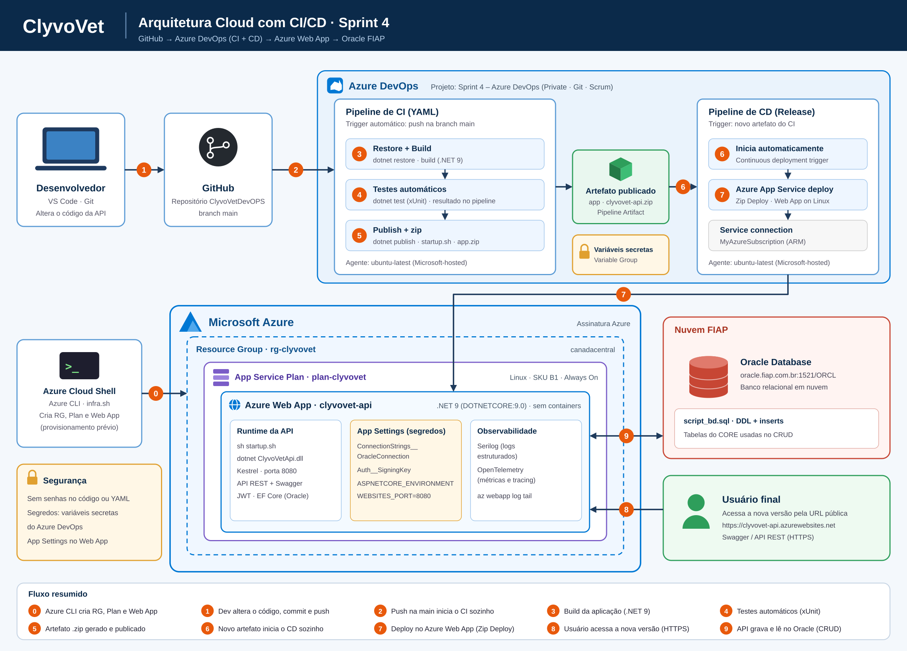

# ClyvoVet — Cuidado Contínuo para seu Pet · Sprint 4 (CI/CD com Azure DevOps)

Entrega da **Sprint 4** da disciplina **DevOps Tools & Cloud Computing** (FIAP, prof. Karlos). A API da ClyvoVet, integrada a um banco Oracle em nuvem, é compilada, testada e publicada **automaticamente** no **Azure App Service** por pipelines de **CI** e **CD** no **Azure DevOps**.

> **Opção de arquitetura:** Azure App Service (Web App Linux). **Nada é containerizado**: nem a aplicação, nem o banco.

## Índice

1. [Descrição da solução](#1-descrição-da-solução)
2. [Benefícios para o negócio](#2-benefícios-para-o-negócio)
3. [Stack de tecnologias](#3-stack-de-tecnologias)
4. [Arquitetura utilizada](#4-arquitetura-utilizada)
5. [Funcionamento do CI/CD](#5-funcionamento-do-cicd)
6. [Variáveis necessárias](#6-variáveis-necessárias)
7. [Procedimento de deploy](#7-procedimento-de-deploy)
8. [CRUD e evidências no banco](#8-crud-e-evidências-no-banco)
9. [Link da aplicação publicada](#9-link-da-aplicação-publicada)
10. [Problemas comuns](#10-problemas-comuns)
11. [Integrantes e entrega](#11-integrantes-e-entrega)

---

## 1. Descrição da solução

A **ClyvoVet** é uma aplicação para clínicas veterinárias que apoia o cuidado contínuo do pet: cadastro de tutores e pets, histórico clínico, consultas e vacinas. O backend é uma **API REST ASP.NET Core** (.NET 9) com autenticação JWT, persistência em **Oracle** (Entity Framework Core) e um serviço em segundo plano (`AlertScheduler`) que faz a varredura preventiva de vacinas.

Nesta Sprint, o foco é a **automação da entrega**: qualquer alteração enviada à branch `main` do GitHub dispara o **CI** (build, testes e geração do artefato) e, na sequência, o **CD** (deploy automático no Azure Web App), sem passos manuais.

## 2. Benefícios para o negócio

- **Atendimento preventivo:** alertas de vacinas pendentes permitem agir antes da queixa clínica.
- **Histórico unificado:** consultas, vacinas e medicações em um prontuário contínuo.
- **Entrega rápida e segura:** cada correção ou melhoria chega à produção em minutos, com testes automáticos que evitam regressões.
- **Menos erro humano:** build, testes e deploy padronizados e repetíveis.
- **Operação observável:** logs estruturados (Serilog) e métricas/tracing (OpenTelemetry).

## 3. Stack de tecnologias

| Camada | Tecnologia |
|---|---|
| Aplicação | C#, ASP.NET Core (.NET 9), Entity Framework Core (Oracle), JWT |
| Testes | xUnit (`dotnet test`) |
| Observabilidade | Serilog, OpenTelemetry |
| Banco de dados | Oracle Database da FIAP (nuvem), acessado via Oracle Managed Data Access |
| Repositório | GitHub |
| CI/CD | Azure DevOps: Pipeline de CI (YAML) + Release de CD (Continuous deployment) |
| Hospedagem | Azure App Service (Plano Linux B1) |
| Infraestrutura como script | Azure CLI (Cloud Shell, `infra.sh`) |

## 4. Arquitetura utilizada



Fluxo numerado do diagrama:

| Nº | Etapa |
|---|---|
| 0 | O **Azure CLI** (Cloud Shell, `infra.sh`) cria o Resource Group, o App Service Plan e o Web App |
| 1 | O desenvolvedor altera o código e faz commit e push na branch `main` |
| 2 | O push na `main` inicia o **CI** automaticamente no Azure DevOps |
| 3 | **Build** da aplicação (`dotnet restore` e `dotnet build`) |
| 4 | **Testes automáticos** (`dotnet test`, xUnit) |
| 5 | Geração e **publicação do artefato** `app` (`app.zip` com o `startup.sh`) |
| 6 | O novo artefato **inicia o CD** automaticamente (Continuous deployment trigger) |
| 7 | **Deploy** do artefato no Azure Web App (Zip Deploy, via *service connection*) |
| 8 | O usuário final acessa a nova versão por HTTPS |
| 9 | A API grava e lê no **Oracle** em nuvem (CRUD) |

**Organização dos recursos no Azure**

```
Assinatura Azure
└── Resource Group: rg-clyvovet
    └── App Service Plan: plan-clyvovet (Linux, B1)
        └── Web App: clyvovet-api (.NET 9)
Nuvem FIAP
└── Oracle Database (oracle.fiap.com.br:1521/ORCL)
```

## 5. Funcionamento do CI/CD

### 5.1 Projeto no Azure DevOps

- **Nome:** `Sprint 4 – Azure DevOps` · **Visibilidade:** Private · **Controle de versão:** Git · **Processo:** Scrum
- O professor (`pfkarlos.lima@fiap.com.br`) foi convidado com nível de acesso **Basic**.
- O repositório do GitHub está conectado ao Azure DevOps (*Pipelines → New pipeline → GitHub (YAML)*).

### 5.2 Pipeline de CI (`azure-pipelines.yml`)

- Conectada ao repositório do GitHub.
- **Inicia automaticamente** a cada push na branch `main`.
- Executa **build**, **testes automáticos** e **publica o artefato** `app` no Azure DevOps.
- Nenhuma senha ou string de conexão no YAML.

```yaml
trigger:
  branches:
    include:
      - main
      - master

pool:
  vmImage: 'ubuntu-latest'

variables:
  buildConfiguration: 'Release'
  apiProject: 'ClyvoVetApi-main/ClyvoVetApi.csproj'
  testProject: '**/*Tests.csproj'
  artifactName: 'app'

stages:
  - stage: CI
    displayName: 'CI - Build e Testes'
    jobs:
      - job: BuildTest
        displayName: 'Compilar, testar e publicar'
        steps:
          - task: UseDotNet@2
            displayName: 'Instalar .NET 9'
            inputs:
              packageType: 'sdk'
              version: '9.0.x'

          - task: DotNetCoreCLI@2
            displayName: 'Restaurar dependências'
            inputs:
              command: 'restore'
              projects: '$(apiProject)'

          - task: DotNetCoreCLI@2
            displayName: 'Build'
            inputs:
              command: 'build'
              projects: '$(apiProject)'
              arguments: '--configuration $(buildConfiguration) --no-restore'

          - task: DotNetCoreCLI@2
            displayName: 'Testes automáticos'
            inputs:
              command: 'test'
              projects: '$(testProject)'
              arguments: '--configuration $(buildConfiguration)'
              testRunTitle: 'Testes ClyvoVet'

          - task: DotNetCoreCLI@2
            displayName: 'Publicar API'
            inputs:
              command: 'publish'
              publishWebProjects: false
              projects: '$(apiProject)'
              arguments: '--configuration $(buildConfiguration) --output $(Build.ArtifactStagingDirectory)/publish'
              zipAfterPublish: false
              modifyOutputPath: false

          - script: |
              printf '#!/bin/sh\nexec dotnet ./ClyvoVetApi.dll\n' > $(Build.ArtifactStagingDirectory)/publish/startup.sh
            displayName: 'Gerar startup.sh'

          - task: ArchiveFiles@2
            displayName: 'Compactar aplicação'
            inputs:
              rootFolderOrFile: '$(Build.ArtifactStagingDirectory)/publish'
              includeRootFolder: false
              archiveType: 'zip'
              archiveFile: '$(Build.ArtifactStagingDirectory)/$(artifactName).zip'
              replaceExistingArchive: true

          - task: PublishPipelineArtifact@1
            displayName: 'Publicar artefato'
            inputs:
              targetPath: '$(Build.ArtifactStagingDirectory)/$(artifactName).zip'
              artifact: '$(artifactName)'
              publishLocation: 'pipeline'
```

**Jobs e tasks do CI**

| Task | Função |
|---|---|
| `UseDotNet@2` | Instala o SDK do .NET 9 no agente |
| `DotNetCoreCLI` restore / build | Restaura pacotes e compila a API |
| `DotNetCoreCLI` test | Executa os testes automáticos (xUnit) e publica o resultado |
| `DotNetCoreCLI` publish | Gera os binários de produção |
| `script` | Cria o `startup.sh` usado pelo Web App |
| `ArchiveFiles@2` | Compacta tudo em `app.zip` (caminhos com `/`, compatível com Linux) |
| `PublishPipelineArtifact@1` | Publica o artefato `app` no Azure DevOps |

### 5.3 Pipeline de CD (Release)

- **Inicia automaticamente** quando um novo artefato do CI é criado (*Continuous deployment trigger* ligado no artefato).
- **Obtém o artefato** `app` publicado pelo CI.
- Faz o **deploy automático** no **Azure Web App** `clyvovet-api` (task *Azure App Service deploy*, Zip Deploy, agente `ubuntu-latest`).
- Usa a **service connection** `MyAzureSubscription`. Nenhuma credencial fica no repositório.

## 6. Variáveis necessárias

Nenhum valor sensível fica no código ou no YAML. Os segredos ficam em **variáveis secretas (cadeado)** do Azure DevOps e são repassados ao Web App por **App Settings**.

| Variável | Onde é definida | Secreta | Descrição |
|---|---|---|---|
| `ConnectionStrings__OracleConnection` | Variables da Release e App Settings do Web App | Sim | Connection string do Oracle (`User Id=<RM>;Password=<senha>;Data Source=oracle.fiap.com.br:1521/ORCL`) |
| `Auth__SigningKey` | Variables da Release e App Settings | Sim | Chave de assinatura dos tokens JWT (32 ou mais caracteres) |
| `ASPNETCORE_ENVIRONMENT` | Variables da Release e App Settings | Não | Ambiente da aplicação (`Development` habilita o Swagger) |
| `WEBSITES_PORT` | App Settings (via `infra.sh`) | Não | `8080` |
| `ASPNETCORE_URLS` | App Settings (via `infra.sh`) | Não | `http://+:8080` |

Na task de deploy da Release, o campo **App settings** recebe:

```
-ConnectionStrings__OracleConnection "$(ConnectionStrings__OracleConnection)" -Auth__SigningKey "$(Auth__SigningKey)" -ASPNETCORE_ENVIRONMENT $(ASPNETCORE_ENVIRONMENT)
```

## 7. Procedimento de deploy

### 7.1 Pré-requisitos

- Conta no GitHub, organização no Azure DevOps e assinatura Azure ativa.
- Usuário e senha do Oracle FIAP.
- No Azure DevOps: *Organization settings → Pipelines → Settings* com **Disable creation of classic release pipelines** em **Off**.

### 7.2 Criar os recursos via Azure CLI

No **Azure Cloud Shell (Bash)**, na raiz do repositório clonado:

```bash
git clone https://github.com/AndreBellandi/ClyvoVetDevOPS.git
cd ClyvoVetDevOPS
chmod +x infra.sh
./infra.sh
```

Conteúdo do `infra.sh`:

```bash
#!/bin/bash
RG=rg-clyvovet
LOCATION=canadacentral
PLAN=plan-clyvovet
APP=clyvovet-api
RUNTIME="DOTNETCORE:9.0"

az provider register --namespace Microsoft.Web

# Grupo de recursos
az group create --name $RG --location $LOCATION

# Plano do serviço (Linux)
az appservice plan create --name $PLAN --resource-group $RG --sku B1 --is-linux

# Serviço de aplicativo (Web App)
az webapp create --name $APP --resource-group $RG --plan $PLAN --runtime "$RUNTIME"

# Configurações do Web App
az webapp config set --name $APP --resource-group $RG --always-on true --startup-file "sh startup.sh"
az webapp config appsettings set --name $APP --resource-group $RG \
  --settings WEBSITES_PORT=8080 ASPNETCORE_URLS=http://+:8080
```

> Se `DOTNETCORE:9.0` não existir na sua região, liste os runtimes com `az webapp list-runtimes --os-type linux` e use o nome exibido. Se o nome `clyvovet-api` estiver em uso, troque por `clyvovet-api-<seu RM>`.

### 7.3 Banco de dados em nuvem (Oracle FIAP)

O banco já existe e é fornecido pela FIAP. Aplique o `script_bd.sql` (DDL + inserts) uma vez, com um cliente como DBeaver ou SQL Developer:

```
Host: oracle.fiap.com.br   Porta: 1521   Serviço: ORCL
Usuário: <seu RM>          Senha: <sua senha do Oracle FIAP>
```

Ou pelo Cloud Shell, com o driver Python em modo *thin* (sem cliente nativo):

```bash
pip install oracledb --user
export RM_FIAP="<seu RM>" SENHA_FIAP="<sua senha>"

cd ClyvoVetApi-main
python3 - <<'EOF'
import os, oracledb
conn = oracledb.connect(user=os.environ["RM_FIAP"], password=os.environ["SENHA_FIAP"],
                        dsn="oracle.fiap.com.br:1521/ORCL")
cur = conn.cursor()
for cmd in [c.strip() for c in open("script_bd.sql", encoding="utf-8").read().split(";") if c.strip()]:
    try:
        cur.execute(cmd); print("OK:", cmd[:60].replace("\n", " "))
    except oracledb.DatabaseError as e:
        print("ERRO:", cmd[:60].replace("\n", " "), "->", e)
conn.commit(); conn.close()
EOF
```

> **Atenção:** confirme a senha no DBeaver **antes** de configurar o Web App. Tentativas repetidas com senha errada (o `AlertScheduler` tenta conectar em segundo plano) bloqueiam a conta Oracle (`ORA-28000`).

### 7.4 Service connection

*Project settings → Service connections → New service connection → Azure Resource Manager*:
- Authentication: **Service principal (automatic)** · Scope: **Subscription**
- Nome: `MyAzureSubscription` · **Grant access permission to all pipelines** marcado

### 7.5 Criar a pipeline de CI

1. *Pipelines → Create Pipeline → GitHub (YAML)* e autorize o Azure Pipelines no GitHub.
2. Selecione o repositório `ClyvoVetDevOPS`.
3. Use o `azure-pipelines.yml` da seção [5.2](#52-pipeline-de-ci-azure-pipelinesyml) (commit na `main`) e clique em **Save and run**.
4. Confirme as etapas verdes, a aba **Tests** e o artefato `app` publicado.

### 7.6 Criar a pipeline de CD (Release)

1. *Pipelines → Releases → New pipeline → template Azure App Service deployment*. Stage `Produção`, pipeline `ClyvoVet - CD`.
2. **Add an artifact:** Source type *Build*, projeto, source = pipeline de CI, versão *Latest*.
3. No **raio** do artefato: ligue **Continuous deployment trigger**.
4. No stage (*1 job, 1 task*):
   - Subscription: `MyAzureSubscription` · App type: **Web App on Linux** · App service: `clyvovet-api`
   - Agent pool: *Azure Pipelines*, `ubuntu-latest`
   - Package: `$(System.DefaultWorkingDirectory)/**/*.zip` · método: **Zip Deploy**
   - Startup command: `sh startup.sh`
   - App settings: conforme a seção [6](#6-variáveis-necessárias)
5. Na aba **Variables** da Release, crie `ConnectionStrings__OracleConnection` e `Auth__SigningKey` (**cadeado**) e `ASPNETCORE_ENVIRONMENT`.
6. **Save → Create release** para o primeiro deploy.

### 7.7 Validar o fluxo automático

1. Faça uma alteração **real no código** da API (por exemplo, o título do Swagger) e faça commit e push na `main`.
2. Confirme que o **CI inicia sozinho**, que o artefato é publicado e que o **CD inicia sozinho**.
3. Acesse `https://clyvovet-api.azurewebsites.net/swagger` e confirme a alteração.
4. Acompanhe o log do app, se necessário:

```bash
az webapp log tail --name clyvovet-api --resource-group rg-clyvovet
```

## 8. CRUD e evidências no banco

O CRUD cobre tabelas relacionadas do **CORE** da aplicação. Cada operação é comprovada com `SELECT` direto no Oracle:

| Operação | Endpoint (exemplo) | Evidência |
|---|---|---|
| Create | `POST /api/pets` | `SELECT * FROM PET WHERE ID = ...` após o insert |
| Read | `GET /api/pets/{id}` | Consulta retornando os dados persistidos |
| Update | `PUT /api/pets/{id}` | `SELECT` mostrando o valor alterado |
| Delete | `DELETE /api/pets/{id}` | `SELECT` mostrando a ausência do registro |

## 9. Link da aplicação publicada

- **Aplicação (Azure Web App):** https://clyvovet-api.azurewebsites.net
- **Swagger:** https://clyvovet-api.azurewebsites.net/swagger

## 10. Problemas comuns

| Sintoma | Causa provável | Solução |
|---|---|---|
| `NETSDK1045` no restore | O projeto usa .NET 9 e o SDK instalado é 8 | `UseDotNet@2` com `9.0.x` |
| App retorna página padrão (`hostingstart.dll`) | Runtime do Web App diferente do projeto, ou `startup.sh` fora do zip | Runtime `DOTNETCORE:9.0` e conferir o conteúdo do `app.zip` |
| `ConnectionStrings:OracleConnection nao configurada` | Variável com nome diferente | Usar exatamente `ConnectionStrings__OracleConnection` |
| `ORA-01017` | Usuário ou senha incorretos | Validar no DBeaver; usar aspas simples no Cloud Shell |
| `ORA-28000` | Conta bloqueada por tentativas erradas | Parar o app e pedir o desbloqueio do usuário |
| `/swagger` retorna 404 | Swagger habilitado só em `Development` | `ASPNETCORE_ENVIRONMENT=Development` |